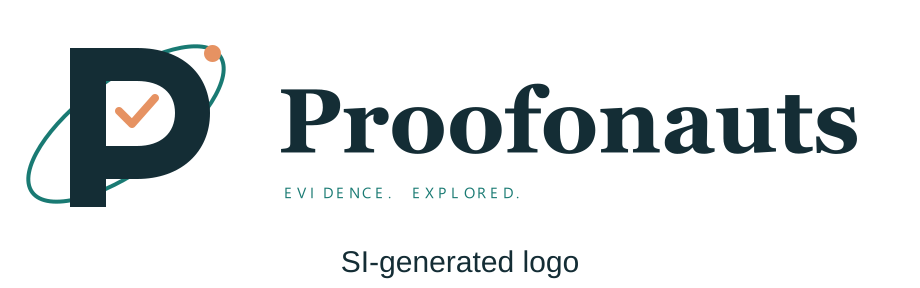
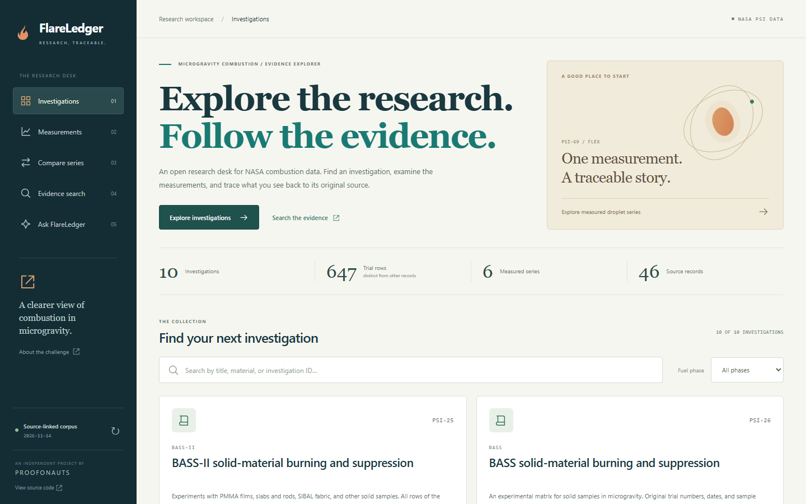
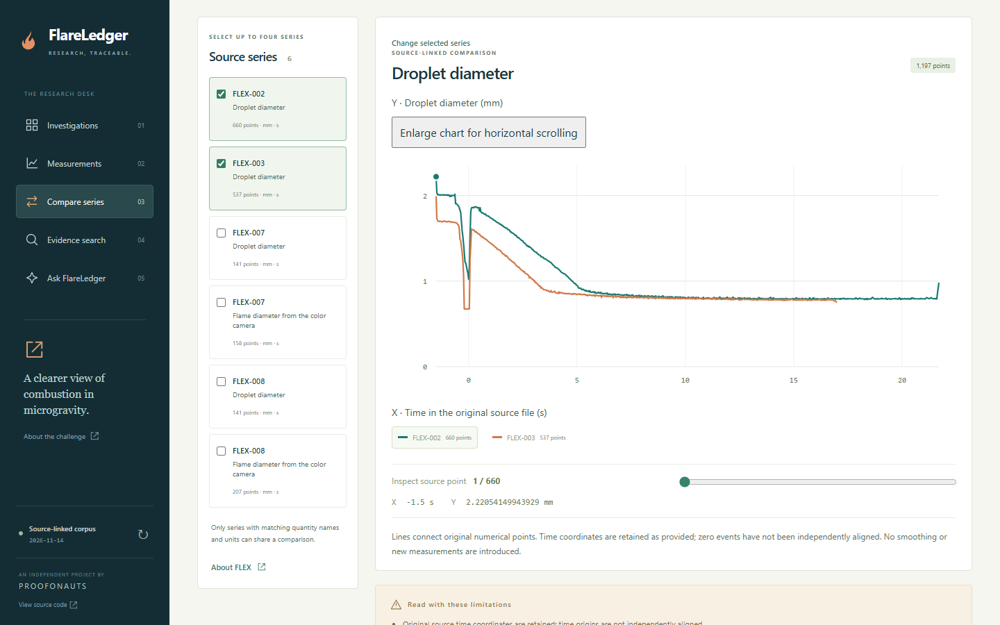

# FlareLedger



**Explore microgravity combustion research. Follow each claim back to its evidence.**

[Open the application](https://flareledger.fun/) | [Screenshot demonstration](presentation/DEMO.md) | [NASA sources](docs/NASA_DATA.md) | [SI disclosure](SI_USAGE.md)

FlareLedger is a research exploration application built by **Proofonauts, a two-person team: Denis Voloshyn and Timofey**. It addresses **Flame in Freefall: SI-Powered Fire Safety Insights from Microgravity Combustion Data**, a 2026 NASA Space Apps challenge. Users browse investigations, inspect original records and source locators, read measured curves, compare compatible series, and ask questions using selected source context.

The purpose is to make evidence easier to inspect. The application does not certify materials, predict safe operating conditions or replace experimental and engineering review.

## Implemented workflow

- Browse and filter ten NASA PSI investigations.
- Inspect original units, missing values, qualifiers, row locators, DOI, file versions, hashes and licenses.
- Explore six measured series with 1,844 original points and compare matching physical quantities and units.
- Search source-linked records; distinguish metadata, trial rows, operating conditions and historical context.
- Use optional Gemini Ask with bounded retrieval, claim-bound citations, server-rendered markers and visible limitations. Retrieved evidence remains available when generation fails.
- Use a responsive Vue interface backed by FastAPI/SQLite, Docker/Compose, CI, monitoring and backup/recovery tooling.





Timofey supplied these captures before the Proofonauts branding refresh. They are application screenshots, not fabricated measurements or proof of a new live Ask. See the [screenshot review](docs/SCREENSHOT_REVIEW.md).

## Data and verification

The frozen snapshot contains 10 investigations, 9 experimental tables, 1,132 records including non-trials, 6 numerical series, 46 source records and 13 quality issues. Its 647 records typed as trial rows are not a validated count of independent experiments. The catalogue's 8,369 entries are external file listings, not 8,369 embedded measurements. No synthetic numerical values are recorded in this snapshot.

Corpus SHA256: `90be248ab23b24f6eaa51e3923ba5937631493630fd4833e18a2dbb51897bc52`.

The last operator-confirmed backend release is `969cb9460de9115fe0a16016bd02bf168aa7175e`. Timofey reported healthy readiness, preserved state and enabled Gemini. New installations still disable generation by default. Shared application limits are 10 reservations per rolling 24 hours, 3 per minute and one active call, with no automatic retry or paid fallback. Remaining quota is transient.

At PR22, 163 backend tests and a 15-question offline inspection passed; 45/45 frozen anchors matched. **These are technical checks, not a 15/15 scientific answer score. The full new-release live answer evaluation and independent scientific review are unfinished.** [Evidence and limitations](docs/RELEASE_STATUS.md).

## Run locally

Requirements: Git, Python 3.12, Node 24 and npm. These commands create local development state; they are not a production update procedure.

```bash
git clone https://github.com/Denofix/flareledger.git
cd flareledger
python3 scripts/check_repository.py
cd backend
python3 -m venv .venv
source .venv/bin/activate
python -m pip install -r requirements-dev.txt
python -m app.ingest
LLM_ENABLED=false python -m uvicorn app.main:app --host 127.0.0.1 --port 8000
```

In a second terminal, from the repository root:

```bash
cd frontend
npm ci
API_PROXY_TARGET=http://127.0.0.1:8000 npm run dev -- --host 127.0.0.1 --port 5173 --strictPort
```

Open <http://127.0.0.1:5173/>. Browsing, search, charts and sources require no Gemini key. Read the [SI runbook](docs/AI_SETUP.md) before deliberate enabled-generation setup; its explicit migration and persistent quotas are separate from corpus import.

## Project structure

| Directory | Responsibility |
| --- | --- |
| backend/ | Python 3.12, FastAPI, SQLite, source retrieval and optional Gemini adapter |
| frontend/ | Vue 3, TypeScript, Vite, measured charts and source-linked interface |
| data/ | Frozen NASA snapshot, source manifests and hash-pinned ReadMe |
| infra/ | Docker, Compose, ingress, monitoring and operational tooling |
| scripts/ | Repository checks, bounded offline inspection and maintenance |
| docs/ | Contracts, source register, submission text, verification and runbooks |
| design/ | Branding provenance and asset credits |
| presentation/ | Screenshot walkthrough, seven-slide plan and pitch script |

## Two-person team

| Member | Contribution |
| --- | --- |
| Denis Voloshyn / [Denofix](https://github.com/Denofix) | Coordination, scope, architecture, source-data preparation, SI integration, retrieval/validation, evaluation tooling and submission material |
| Timofey / [Tymofii1912](https://github.com/Tymofii1912) | Infrastructure, Docker/CI, VPS delivery, monitoring, verified backups, PR review, interface checks, screenshots and SI-assisted branding |

We practised full-stack integration, provenance, scientific-data handling, bounded LLM integration, tests, Git review, Linux operations, deployment, backup recovery, responsive verification and English technical communication. [Practical contributions and learning](docs/TEAM_AND_LEARNING.md) records concrete outcomes without claiming scientific accreditation.

Code, text and parts of the design were developed with neural-network assistance. Gemini can generate runtime interpretations from selected context. [SI_USAGE.md](SI_USAGE.md) discloses tools, uses, human responsibilities and visible logo markings. Original measurements are not represented as generated data.

## Submission materials and scope

[English form text](docs/submission/FIELD_TEXT.md), [submission checklist](docs/submission/CHECKLIST.md), [NASA source register](docs/NASA_DATA.md), [screenshot walkthrough](presentation/DEMO.md), [seven-slide plan](presentation/SLIDES_7.md) and [three-minute pitch](presentation/PITCH_3MIN.md) are included. A walkthrough or source repository does not replace the required public slide file/PDF or short video.

Independent hackathon project. NASA has not reviewed or endorsed FlareLedger or its interpretations. Original code and project documentation use the [MIT License](LICENSE); third-party data and media retain their own terms under [DATA_LICENSES.md](DATA_LICENSES.md).

See also [team rules](TEAM_RULES.md), [contribution workflow](CONTRIBUTING.md), [technical contract](docs/TECHNICAL_CONTRACT.md), [deployment](docs/DEPLOYMENT.md) and [backup/recovery](docs/BACKUP_RECOVERY.md).
