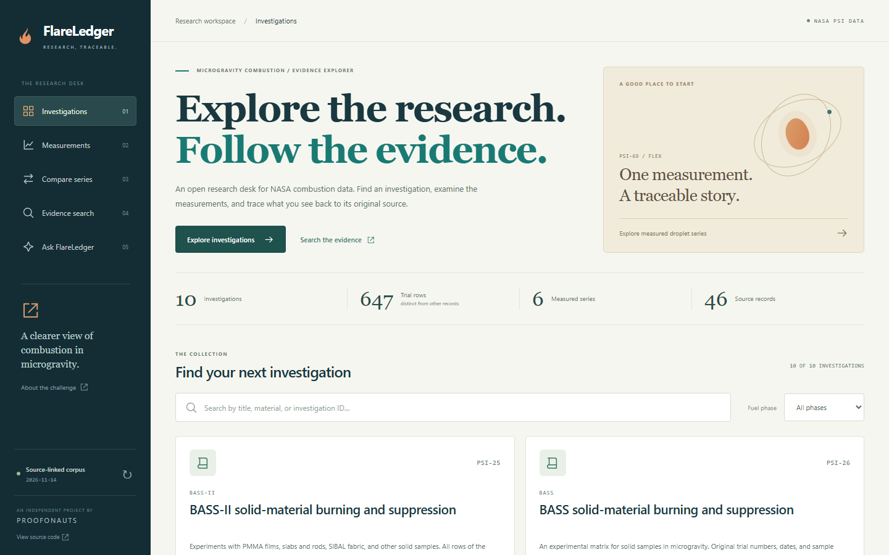
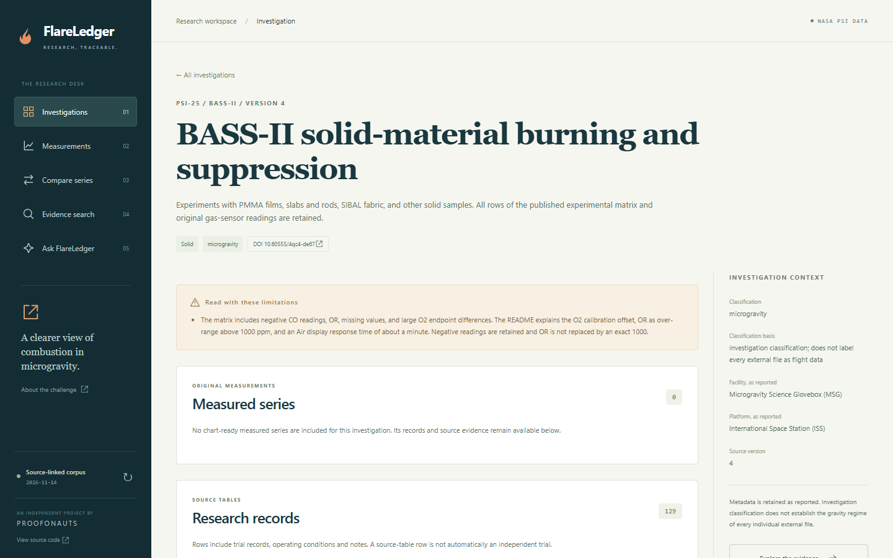
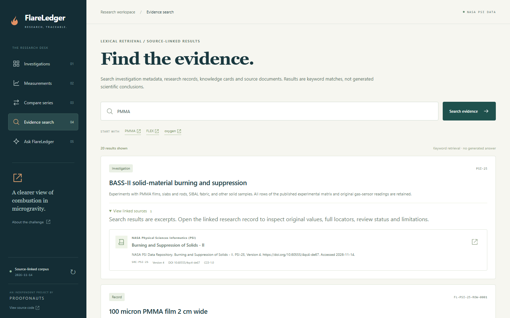
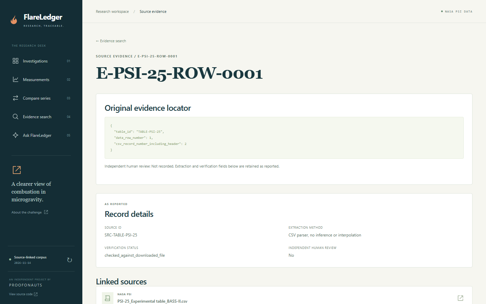
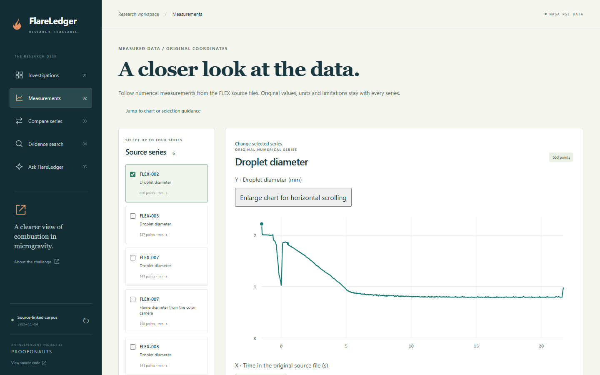
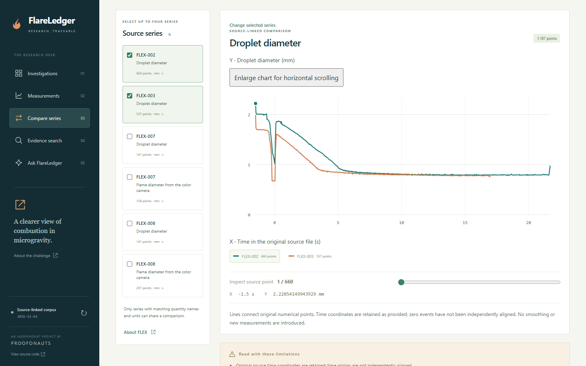
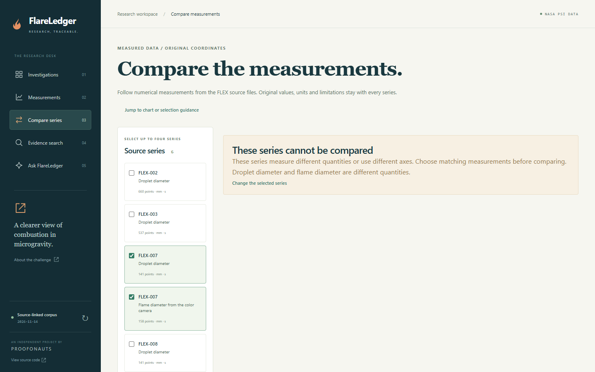
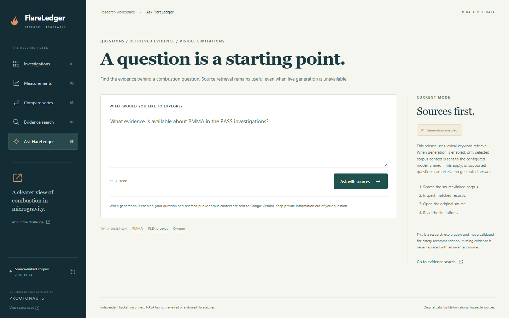
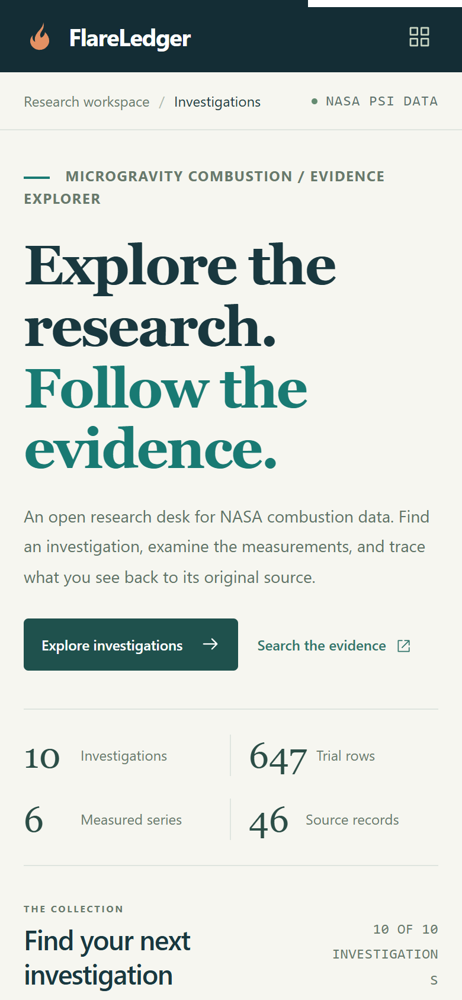
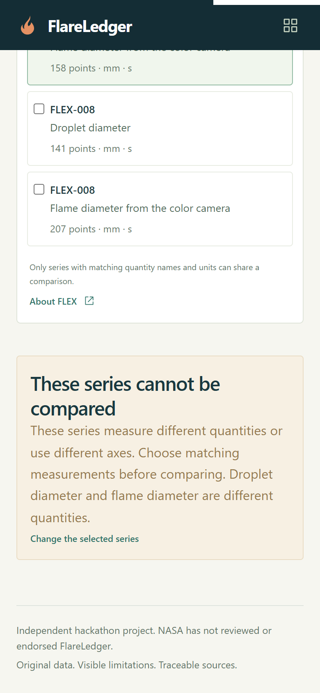

# FlareLedger: screenshot demonstration

**Team:** Proofonauts - Denis Voloshyn and Timofey.
**Challenge:** Flame in Freefall: SI-Powered Fire Safety Insights from Microgravity Combustion Data.
**Application:** <https://flareledger.fun/>. **Code:** <https://github.com/Denofix/flareledger>.

Timofey supplied these unmodified application screenshots. Their capture release was not attested in the archive, and they show the earlier flame branding. They are not proof of a new live Ask or a completed scientific evaluation. [Original image manifest](screenshots/manifest.json).

## 1. Find an investigation

Browse and filter ten investigations. The displayed trial-row count is a classification, not a validated number of independent experiments.

## 2. Inspect conditions and limitations

Read scope, source-linked records and quality warnings. Original units, blanks and over-range qualifiers are not silently corrected.

## 3. Search and trace a source

Lexical search finds related records; a search hit alone is not proof of complete model context.

Trace a record back to a file and row. Source pages show identifiers, versions, hashes and licensing information.

## 4. Read measured curves

Inspect original time coordinates, diameter and units. Camera limits and unknown time-zero events cannot be fixed by inventing points.

## 5. Compare suitable quantities

Matching quantities and units permit an overlay, but do not prove matched conditions or a causal effect.

Droplet diameter and flame diameter do not become the same quantity because both use millimetres.

## 6. Ask within the evidence boundary

This capture is **a question form, not a generated answer**. Ask can return an interpretation, insufficient evidence, rate limiting or unavailability. A genuine current-release generated-answer capture with citations and limitations remains needed; do not fabricate it from this form.

## 7. Use the interface on mobile

The archive also includes 360 px captures and chart enlargement/scroll sequences at 390 and 1024 px. Screenshots establish visible states, not a complete accessibility or interaction audit.

## Suggested demonstration route

Catalogue -> PMMA search -> source/row -> FLEX-002 -> compatible comparison -> incompatible refusal -> explain Ask's limits. Avoid an unplanned model call during the pitch. Use a labelled saved result or source-first fallback when live quota is unavailable.

This is research exploration, not validated fire-safety advice. NASA has not endorsed FlareLedger. This Markdown walkthrough supports the project description; it does not replace the official seven-slide/30-second demo file.
